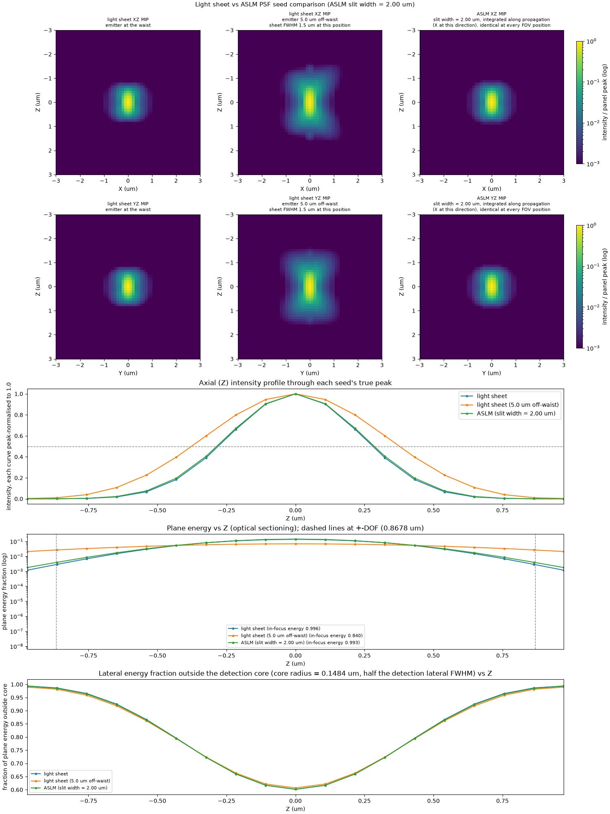

# lsm-psf-analysis

Two standalone simulation scripts that quantify optical trade-offs between static light-sheet microscopy (SPIM) and Axially Swept Light-Sheet Microscopy (ASLM). Written as part of a comparative study on high-resolution 3D tissue imaging at the [Dean Lab, UT Southwestern Medical Center](https://www.dean-lab.org).

---

## Scripts

### `resolution_vs_fov_by_na.py`
Sweeps illumination NA across six values (0.10, 0.15, 0.25, 0.35, 0.45, 0.60) and plots the system-PSF axial FWHM vs. position along the beam propagation axis for both static light-sheet and ASLM at each NA. Detection NA is held fixed at 1.1 throughout.

**Output:** `output/resolution_vs_fov_by_na.pdf` — one page per illumination NA, two curves per page (static light-sheet and ASLM).

### `light_sheet_vs_aslm.py`
Generates PSF seeds for three imaging conditions and produces a side-by-side comparison figure:
- SPIM at waist
- SPIM 5 µm off-waist
- ASLM (slit width 2.0 µm, sweep-integrated)

**Output:** `output/light_sheet_vs_aslm.png` — three maximum-intensity projections (one per condition) alongside energy fraction and axial intensity profiles.

---

## Optical model

Both scripts use an ideal cylindrical-lens illumination beam (scalar 1-D Debye integral, focused along the detection axis, uniform along y, Gaussian-apodized at fill factor 0.7). The ASLM curve is flat by construction under perfect shutter/beam synchronization. Sampling is cubic (dz = dxy) with ni0 = ni throughout.

These are design-limit simulations, not empirical fits. Limitations are printed to stdout at runtime and documented in each script's module docstring.

---

## Requirements

Python 3.10–3.12. Dependencies are declared inline via [PEP 723](https://peps.python.org/pep-0723/) and managed automatically by [uv](https://github.com/astral-sh/uv):

```
numpy>=1.24
scipy>=1.10
psfmodels>=0.3
matplotlib>=3.8
```

The upper Python bound (< 3.13) ensures uv selects an interpreter with a prebuilt `psfmodels` wheel. A newer interpreter may trigger a source build requiring MSVC on Windows.

---

## Usage

```bash
# Install uv if you don't have it
pip install uv

# Run either script directly — dependencies install automatically
uv run resolution_vs_fov_by_na.py
uv run light_sheet_vs_aslm.py
```

Output is written to an `output/` subdirectory created beside each script.

---

## Output figures



Resolution vs. FOV curves by illumination NA are in `output/resolution_vs_fov_by_na.pdf`.
